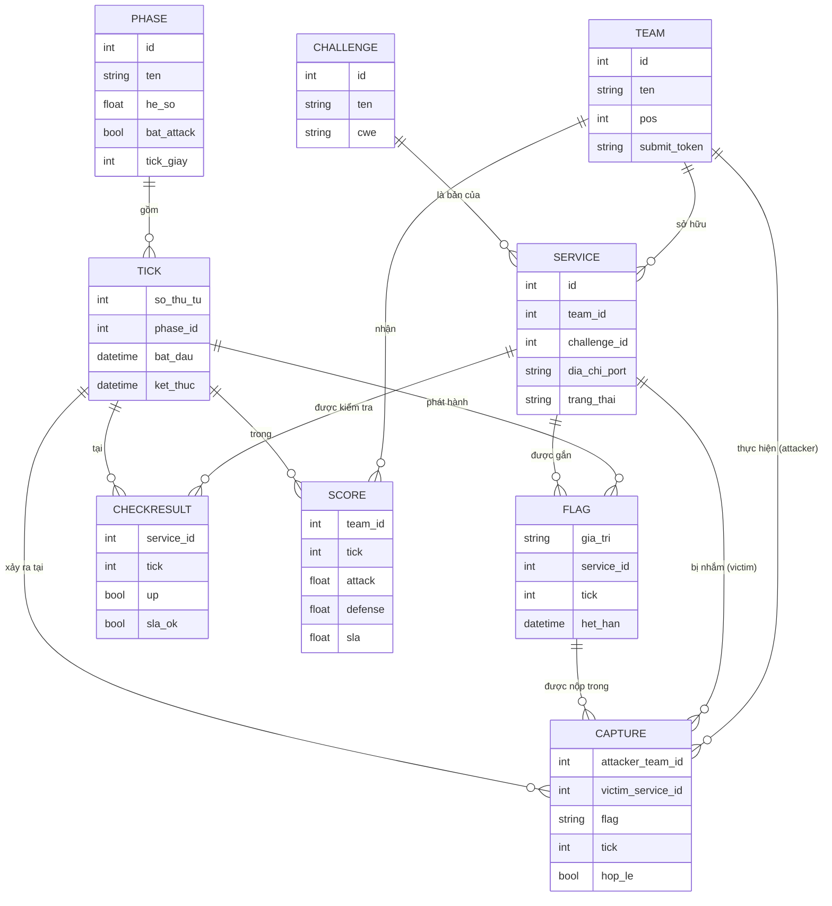

# Mô hình hóa cuộc thi Attack–Defense

*Tài liệu lý thuyết – xác định các thực thể và quan hệ của cuộc thi.*

## 1. Mục đích

Trước khi triển khai, cuộc thi cần được mô hình hóa thành các **thực thể (entity)** rõ ràng và **quan hệ** giữa chúng. Mô hình này là cơ sở để thiết kế cơ sở dữ liệu điểm, bộ chấm (scoring) và scoreboard, đồng thời giúp mọi người hiểu thống nhất "ai là gì, gắn với cái gì".

## 2. Danh sách thực thể

| Thực thể | Ý nghĩa | Thuộc tính chính |
| --- | --- | --- |
| **Team (Đội)** | Một đội thi, sở hữu một môi trường riêng. | id, tên, thứ hạng hiện tại (pos), token-nộp-flag |
| **Phase (Vòng)** | Giai đoạn thi với luật riêng. | id, tên (Củng cố/Đầy đủ/Tăng tốc), hệ số, cờ bật Attack, độ dài tick |
| **Tick (Nhịp/Round)** | Đơn vị thời gian nhỏ nhất để xoay flag và chấm điểm. | số thứ tự, phase, thời điểm bắt đầu/kết thúc |
| **Challenge** | Bài toán/lỗ hổng được dùng (ở đây: ServiceDesk IDOR). | id, tên, loại lỗ hổng (CWE), mô tả |
| **Service (Dịch vụ)** | Bản chạy cụ thể của challenge trên môi trường một đội. | id, team, challenge, địa chỉ:port, trạng thái UP/DOWN |
| **Flag** | Chuỗi bí mật được đặt vào service mỗi tick, cần bảo vệ/đoạt lấy. | giá trị, service bị gắn, tick phát hành, thời hạn |
| **Capture / Submission** | Một lần đội tấn công nộp flag của service đối thủ. | attacker, victim-service, flag, tick, hợp-lệ? |
| **CheckResult** | Kết quả checker kiểm tra một service trong một tick. | service, tick, UP/DOWN, SLA-OK?, flag-đặt-được?, flag-đọc-lại-được? |
| **Score** | Điểm của một đội trong một tick, tách ba thành phần. | team, tick, attack, defense, sla |

## 3. Quan hệ giữa các thực thể

- Một **Team** sở hữu một (hoặc nhiều) **Service**; mỗi Service là một bản của một **Challenge**.
- Một **Phase** gồm nhiều **Tick**; mỗi **Tick** thuộc đúng một **Phase**.
- Mỗi **Tick** phát hành một **Flag** cho mỗi **Service** (flag xoay theo tick).
- Một **Capture** nối một **Team** (attacker) với một **Service** của team khác (victim), gắn với một **Flag** và một **Tick**.
- Mỗi **Tick** sinh một **CheckResult** cho từng **Service**.
- **Score** của một (Team, Tick) được tính từ tập **Capture** (ra điểm Attack) và **CheckResult** (ra điểm Defense, SLA).

## 4. Sơ đồ thực thể – quan hệ (ER)

## 5. Ánh xạ sang công thức chấm điểm

Mô hình trên cung cấp đủ dữ liệu cho công thức ở tài liệu *Thể lệ & luật chơi*:

- **`C_f`** (số đội cùng capture một flag) = đếm các **Capture** hợp lệ trỏ tới cùng **Flag** trong một **Tick**.
- **`N_D`** (số đội phòng thủ thành công) = đếm các **Service** cùng loại có **CheckResult.up = true** và **không** xuất hiện trong **Capture** hợp lệ nào ở tick đó.
- **`pos_A`, `pos_V`** = `Team.pos` của attacker và victim, lấy ở đầu tick.
- **`I_UP`** = `CheckResult.up`.

## 6. Bất biến (ràng buộc) của mô hình

1. Mỗi (Service, Tick) có **đúng một** Flag còn hiệu lực.
2. Một Capture chỉ hợp lệ nếu `attacker_team ≠ victim_service.team` và `flag.tick = tick hiện tại`.
3. Cùng một (attacker, flag) chỉ được tính điểm **một lần**.
4. Score của một (Team, Tick) tồn tại chỉ sau khi tick đã **chốt** (đã có đủ Capture và CheckResult).
