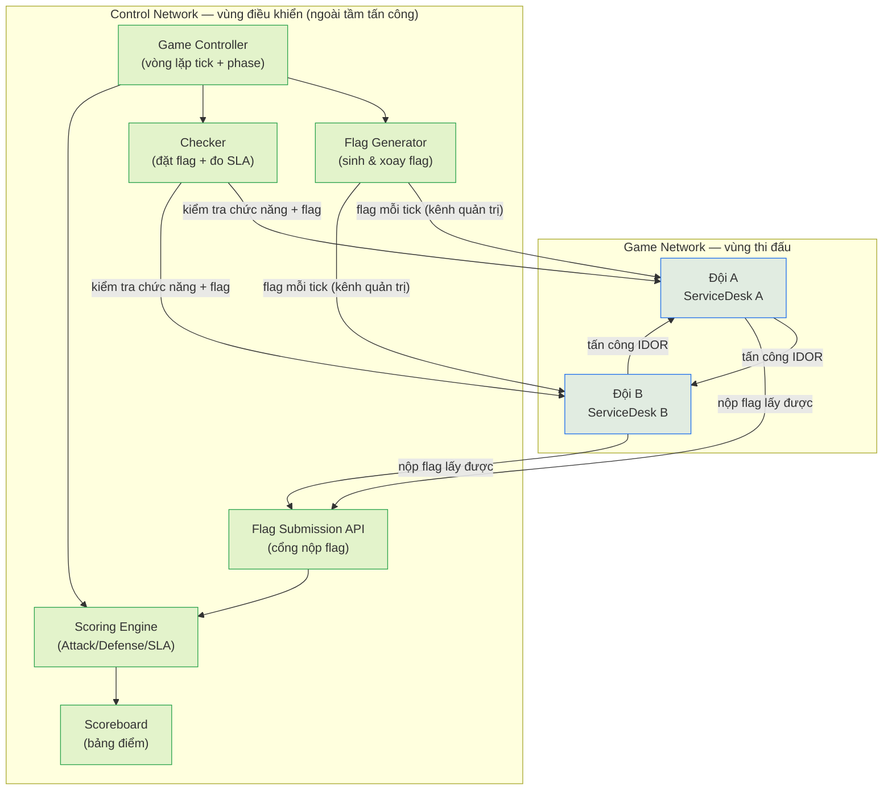

# Sơ đồ hệ thống và sơ đồ tuần tự

*Tài liệu lý thuyết – sơ đồ mô hình hệ thống và sơ đồ tuần tự một tick.*

## 1. Sơ đồ mô hình hệ thống

Hệ thống chia hai vùng mạng: **Game Network** (nơi thí sinh tấn công/phòng thủ) và **Control Network** (hạ tầng điều khiển, ngoài tầm tấn công). Thí sinh chỉ chạm tới service các đội và cổng nộp flag; mọi thành phần chấm điểm nằm trong vùng điều khiển.



**Ghi chú luồng:**
- **Flag Generator → service đội:** đặt flag mới mỗi tick qua kênh quản trị có khóa riêng (thí sinh không truy cập được).
- **Checker → service đội:** mỗi tick kiểm tra chức năng hợp lệ (đăng nhập/đọc/ghi/đọc lại flag) để quyết định `I_UP` (SLA).
- **Đội → Submission API:** nộp flag lấy được từ đối thủ; API chuyển cho Scoring Engine kiểm tra hợp lệ.
- **Scoring → Scoreboard:** cập nhật điểm cuối mỗi tick.

## 2. Sơ đồ tuần tự một tick (Sequence Diagram)

Thể hiện thứ tự tương tác và **thời điểm gọi checker** cùng cách xử lý kết quả trong một tick.

```mermaid
sequenceDiagram
    autonumber
    participant GC as Game Controller
    participant FG as Flag Generator
    participant SA as Service đội A (victim)
    participant TB as Thí sinh đội B (attacker)
    participant CK as Checker
    participant SUB as Submission API
    participant SC as Scoring Engine
    participant SB as Scoreboard

    Note over GC: Bắt đầu tick N (chốt rank đầu tick)
    GC->>FG: Yêu cầu sinh flag cho mọi service
    FG->>SA: Đặt FLAG{A_TN_...} vào ticket mật (kênh quản trị)

    Note over TB,SA: Pha tấn công – phòng thủ
    TB->>SA: GET /api/tickets/<id> (dò id ticket mật)
    alt Service A còn lỗi (vulnerable)
        SA-->>TB: Trả toàn bộ ticket (lộ flag)
        TB->>SUB: Nộp FLAG{A_TN_...}
        SUB->>SC: Chuyển flag để kiểm tra
        SC-->>SUB: Hợp lệ (đúng tick, đúng victim) → ghi Capture
    else Service A đã vá (patched)
        SA-->>TB: 403 Forbidden (không lộ flag)
    end

    Note over GC,CK: Gần cuối tick – gọi Checker
    GC->>CK: Kiểm tra mọi service
    CK->>SA: Đăng nhập + đọc/ghi ticket + đọc lại flag
    alt Chức năng hợp lệ
        SA-->>CK: OK → I_UP = 1 (SLA đạt)
    else Hỏng chức năng / không phản hồi
        SA-->>CK: Lỗi → I_UP = 0 (DOWN)
    end
    CK-->>SC: Trả CheckResult (UP/DOWN) từng service

    Note over SC: Chốt tick N
    SC->>SC: Tính C_f, N_D; Attack = 1 + 1/C_f + R(A,V)
    SC->>SC: Defense = (2 + 1/N_D) × I_UP; SLA = 3 × I_UP
    SC->>SB: Cập nhật điểm A và B
    SB-->>GC: Bảng điểm tick N sẵn sàng
    Note over GC: Chuyển sang tick N+1
```

## 3. Trình tự tóm tắt của một tick

1. **Đầu tick:** chốt thứ hạng; Flag Generator đặt flag mới vào mọi service.
2. **Trong tick:** thí sinh tấn công service đối thủ; nếu lấy được flag thì nộp lên Submission API; Scoring ghi nhận Capture hợp lệ.
3. **Cuối tick:** Checker kiểm tra chức năng hợp lệ của mọi service để xác định `I_UP`.
4. **Chốt tick:** Scoring tính `C_f`, `N_D` rồi ra điểm Attack/Defense/SLA; Scoreboard cập nhật.
5. **Lặp** sang tick kế tiếp.
